<div align="center">

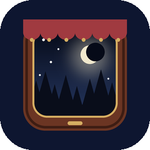

# Night Train

### A date for two, as fellow travellers.

*People tell a stranger on a train what they never tell those closest to them. Night Train gives a couple that evening: a compartment with the phone as the table between you, a polite conductor with hundreds of questions, a window full of passing landscapes, stations with rules, fellow passengers who sit down for a while, a restaurant car, and a tunnel where the most honest things get said. Free, no ads, no account, no internet permission.*

[](https://github.com/bigdevwhale/night-train/actions/workflows/android.yml)
[](https://github.com/bigdevwhale/night-train/releases/latest)


[](LICENSE)

**English** · [Русский](README.ru.md) · [Changelog](CHANGELOG.md)

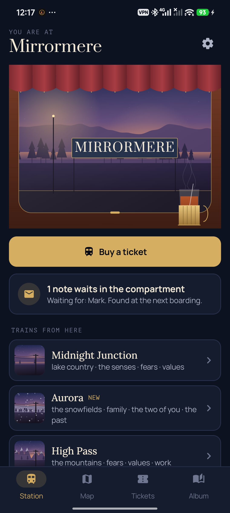 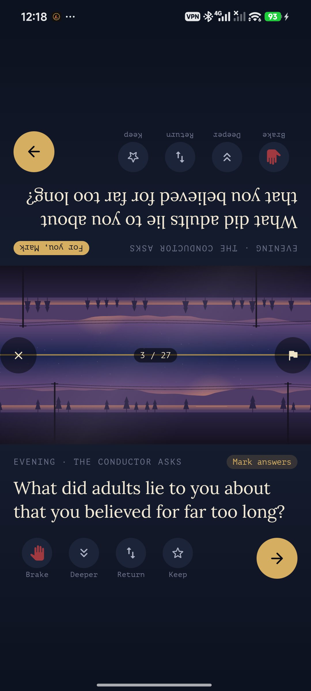 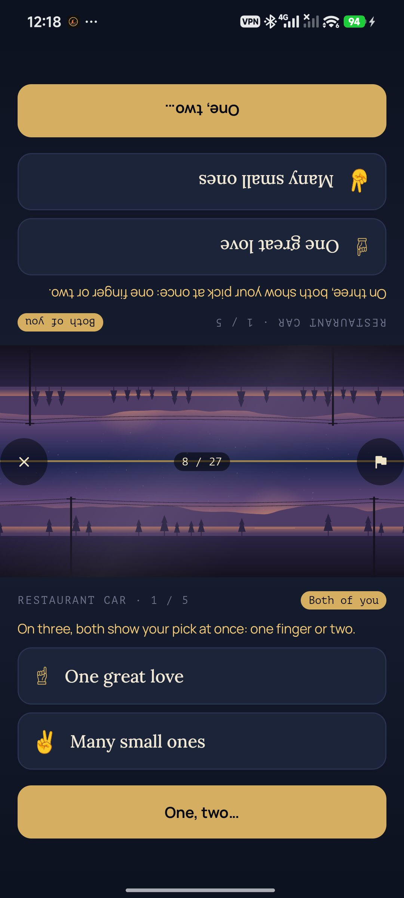 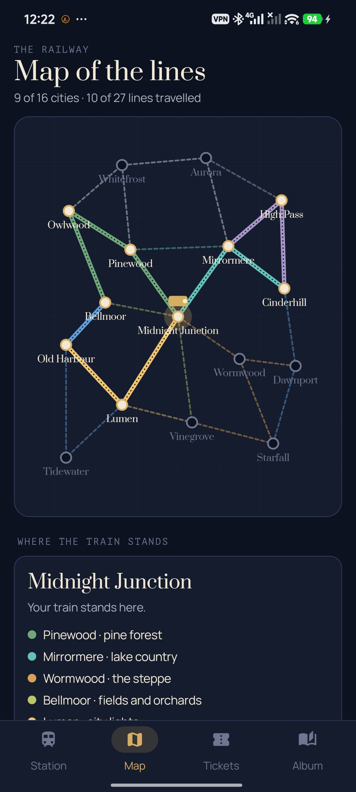

</div>

---

## The idea

The longer two people are together, the more they assume they already know each other, and the fewer real questions get asked. Night Train puts you back on a train as strangers for an evening.

- **The phone is the table.** Sitting face to face, the screen splits in two: the top half is turned to the person opposite, the bottom half to you, and between them are two windows back to back, one on each side of the line. Every card shows on both halves, with its buttons, so either of you can answer, skip or go on.
- **The night deepens.** Each trip runs from evening (light and playful) through the night (personal) and a tunnel (the most open, in the dark) to dawn (warm, about the two of you). The gradual, mutual openness follows Arthur Aron's study of how people grow close.
- **Guessing each other.** Some questions are guessed first: one of you says out loud what the other will answer. A hit punches a hole in your ticket; a miss is something new about the person opposite. Over trips you can see whether you're getting better at it, which is John Gottman's idea of "love maps".

## Built to be played again and again

| | What changes every time | How |
|---|---|---|
| 🃏 | **658 cards, never the same twice** | 359 conductor's questions across 12 subjects and 4 stages of the night, 96 fellow passengers' questions, 45 whistle-stop actions, 90 restaurant-car dilemmas, 32 follow-ups and 36 for the sleeping car. No question comes back until its whole stage has been heard. |
| 🗺️ | **A railway to explore** | 16 cities and 27 lines across eight landscapes: pine forest, coast, lake country, mountains, steppe, snowfields, city lights, fields and orchards. Each landscape is its own view from the window and tilts the conductor toward its subjects (the forest brings back childhood, the coast brings out dreams). Each trip leaves from where the last one arrived. |
| 🚉 | **Stations with rules** | Mirror Halt (answer as the other would), Three Words, Ten Summers (at ten, then now), Hush, Crossing, Long Look, Handfast, Still Water (ten seconds of silence) and Crooked Lanes, where one answer on the stretch is a secret lie to be found out. |
| 🧳 | **Fellow passengers** | An old sailor, a girl with a kitten, a fortune teller, a poet, a granny with pies, a time traveller, a silent monk who asks for answers without words, and the ticket inspector with five-second rapid fire. The ones you met most recently sit the next trip out. |
| 🍷 | **The restaurant car** | Five "this or that" pairs; on three you both show one finger or two, and the table counts how alike you are. |
| ⛰️ | **Whistle-stops** | Two minutes off the train for something to do together: draw each other blind, hum a song for your 80th birthday, swap a piece of clothing. |
| 🚇 | **The tunnel and the sleeping car** | Both thumbs held down to go in; either of you can take the train round instead, no reason needed. The 18+ sleeping car is off unless you switch it on. |
| ✉️ | **Notes in the compartment** | At arrival each of you can leave a note for the other. It stays folded until the next boarding. |
| 🔁 | **The same train** | A postcard you kept comes back a month or more later: the same question, with what you said then. What has changed? |
| 🎫 | **Tickets and an album** | Every trip is a punched ticket with carriage and seats; the album collects a postcard from each city and the answers you kept. |

Also: three trains (Local ~25 min, Express ~1 hour, Night train for the whole evening), a "deeper" button for a follow-up after any answer, a return ticket to send a question back, the emergency brake to skip any card without a word, wheels on the rails, and a backup to one file.

## Privacy

No account, no cloud, no analytics, no internet permission. Everything stays on the phone.

## Screenshots

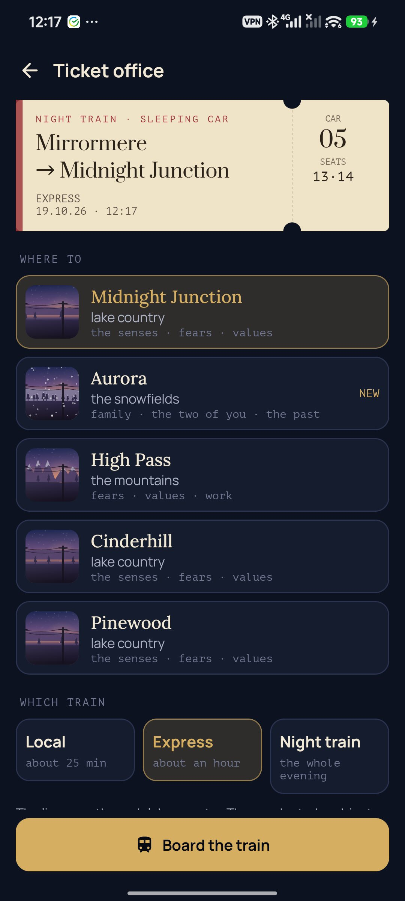 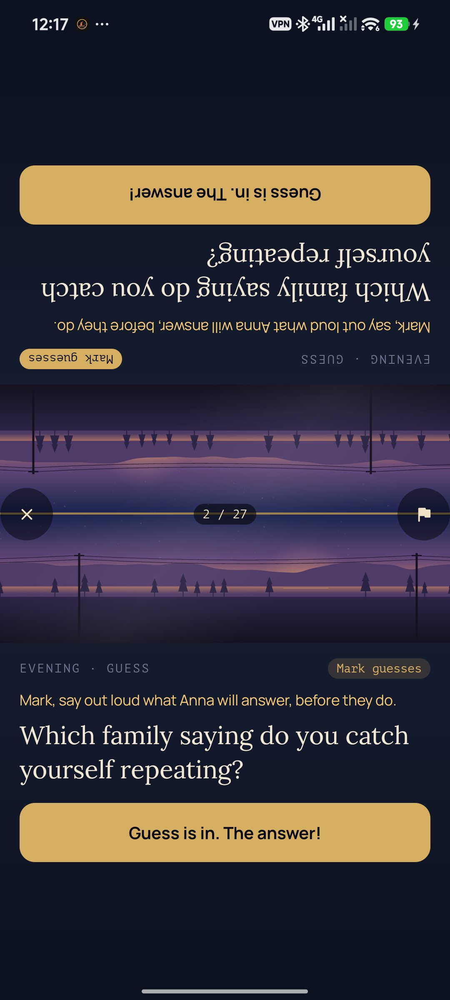 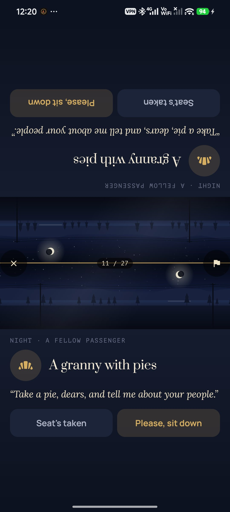 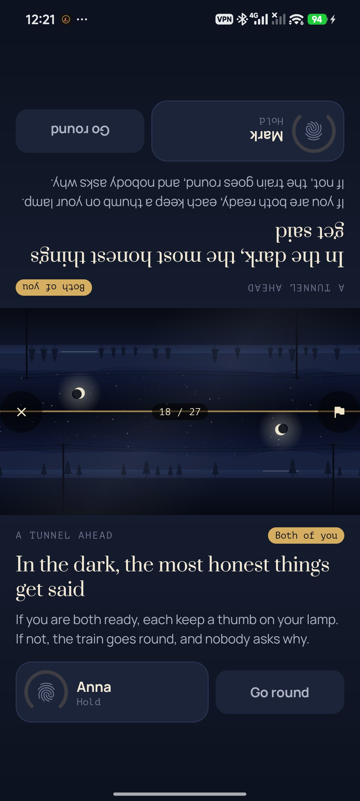 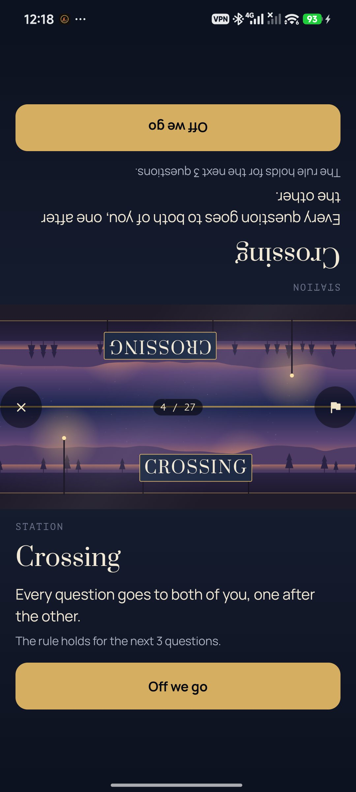 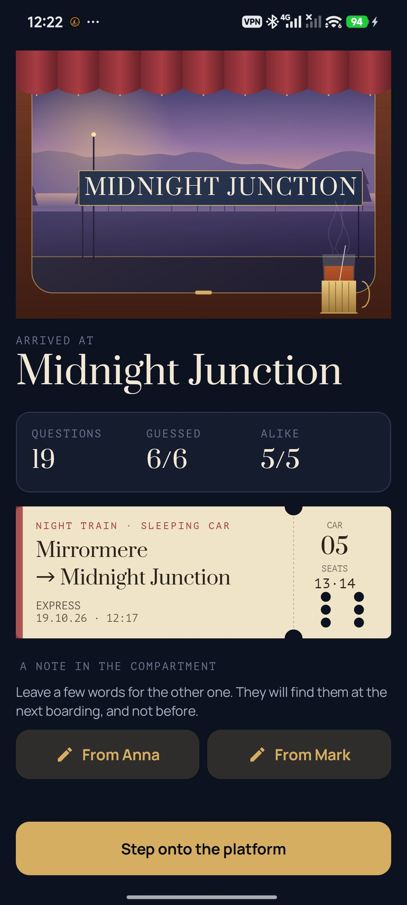 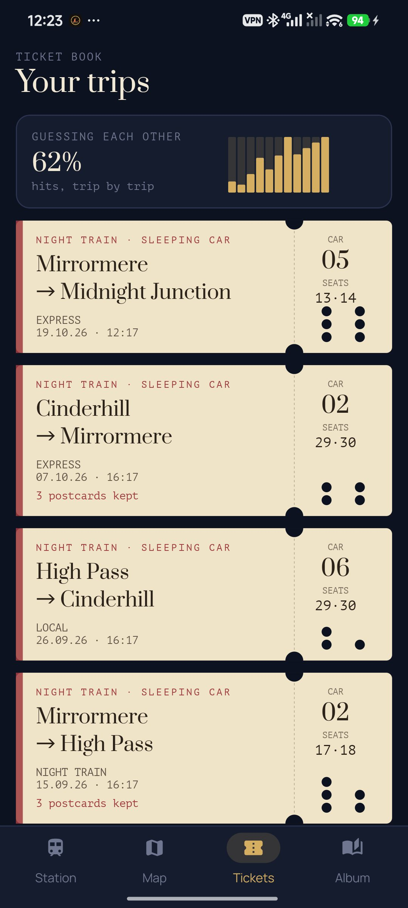 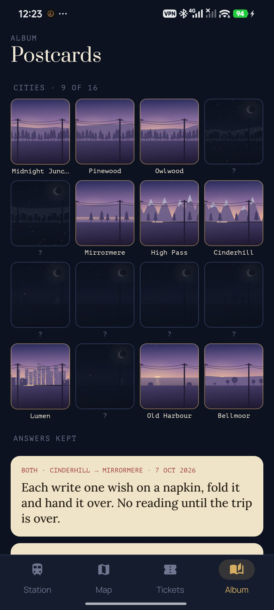

## Build

```bash
./gradlew assembleDebug                 # app.nighttrain.dev
./gradlew assembleDebug -Pdemo          # app.nighttrain.demo, four made-up months of trips
./gradlew testDebugUnitTest             # unit tests: the deck, the trip planner, the railway, backups
./gradlew assembleDebug -Pdemo -Pshots  # app.nighttrain.shots, the window holds still
bash tools/capture.sh docs/screenshots/en en   # rides one trip on a phone and takes the screenshots
python tools/strings.py app/src/main/res       # both languages' strings from one table
```

The cards live in `app/src/main/assets/cards/*.tsv`, one per line: id, kind, stage, theme, flags, English, Russian. Kotlin, Jetpack Compose, Room, DataStore. The landscapes, the window, the map and the tickets are drawn procedurally on a Compose canvas; the wheels are synthesised. Fonts: Prata, Lora, Manrope and PT Mono (OFL).

Part of [Stillcraft](https://bigdevwhale.github.io/stillcraft/). MIT licence.
