<div align="center">


# Ночной поезд

### Свидание для двоих — как для попутчиков.

*Случайному попутчику в поезде рассказывают то, чего не говорят самым близким. «Ночной поезд» дарит паре такой вечер: купе, где телефон — это стол между вами, вежливый проводник с сотнями вопросов, окно с бегущими пейзажами, станции со своими правилами, попутчики, которые подсаживаются ненадолго, вагон-ресторан и туннель, где говорится самое честное. Бесплатно, без рекламы, без аккаунта и без доступа в интернет.*

[](https://github.com/bigdevwhale/night-train/actions/workflows/android.yml)
[](https://github.com/bigdevwhale/night-train/releases/latest)


[](LICENSE)

[English](README.md) · **Русский** · [Изменения](CHANGELOG.md)

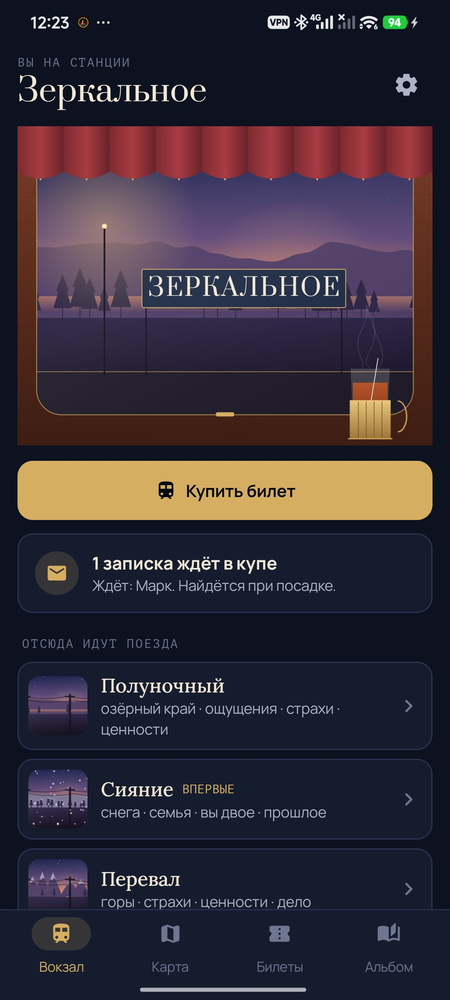 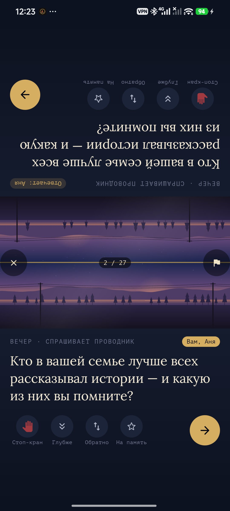 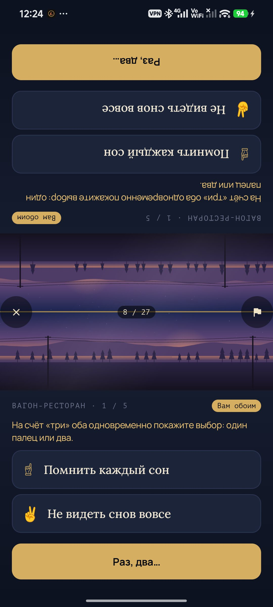 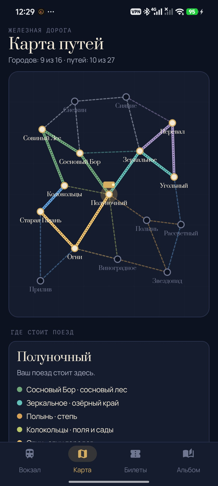

</div>

---

## Идея

Чем дольше люди вместе, тем увереннее им кажется, что они друг друга уже знают, и тем реже звучат настоящие вопросы. «Ночной поезд» на один вечер снова сажает вас в поезд как незнакомцев.

- **Телефон — это стол.** Когда вы сидите друг напротив друга, экран делится пополам: верхняя половина повёрнута к человеку напротив, нижняя — к вам, а между ними два окна спина к спине, по одному с каждой стороны пути. Каждая карточка видна на обеих половинах вместе с кнопками, так что отвечать, пропускать и ехать дальше может любой из вас.
- **Ночь становится глубже.** Каждый рейс идёт от вечера (легко и игриво) через ночь (личное) и туннель (самое откровенное, в темноте) к рассвету (тепло, про вас двоих). Постепенная взаимная откровенность — по следам исследования Артура Арона о том, как люди сближаются.
- **Угадать друг друга.** Некоторые вопросы сначала угадывают: один из вас вслух говорит, что ответит другой. Попадание — дырочка в билете, промах — что-то новое о человеке напротив. От рейса к рейсу видно, лучше ли у вас получается — это идея «карт любви» Джона Готтмана.

## Чтобы играть снова и снова

| | Что меняется каждый раз | Как |
|---|---|---|
| 🃏 | **658 карточек, без повторов** | 359 вопросов проводника по 12 темам и 4 частям ночи, 96 вопросов попутчиков, 45 заданий на полустанках, 90 дилемм вагона-ресторана, 32 уточнения «а глубже?» и 36 для спального вагона. Ни один вопрос не повторится, пока не прозвучит вся его часть ночи. |
| 🗺️ | **Железная дорога** | 16 городов и 27 путей через восемь пейзажей: сосновый лес, морское побережье, озёрный край, горы, степь, снега, огни городов, поля и сады. У каждого пейзажа свой вид из окна, и он склоняет проводника к своим темам (лес возвращает в детство, море — к мечтам). Новый рейс уходит оттуда, куда прибыл прошлый. |
| 🚉 | **Станции с правилами** | Зеркальная (отвечайте за другого), Три Слова, Десятилетка (сначала в десять лет, потом сейчас), Тихая, Разъезд, Смотровая, Ладони, Тихий Омут (десять секунд тишины) и Кривые Дорожки, где один ответ на перегоне — тайная неправда, которую нужно вычислить. |
| 🧳 | **Попутчики** | Старый моряк, девочка с котёнком, гадалка, поэт, бабушка с пирожками, путешественник во времени, молчаливый монах, который просит отвечать без слов, и ревизор с вопросами на пять секунд. Те, кого вы встретили недавно, следующий рейс пропускают. |
| 🍷 | **Вагон-ресторан** | Пять пар «то или это»: на счёт «три» оба показываете один палец или два, а столик считает, насколько вы похожи. |
| ⛰️ | **Полустанки** | Две минуты вне поезда, чтобы что-то сделать вместе: нарисовать друг друга не глядя, напеть песню для своего 80-летия, обменяться вещью. |
| 🚇 | **Туннель и спальный вагон** | Чтобы въехать, оба держат палец; любой может отправить поезд в объезд, без объяснений. Спальный вагон 18+ выключен, пока вы его не включите. |
| ✉️ | **Записки в купе** | По прибытии каждый может оставить записку другому. Она останется сложенной до следующей посадки. |
| 🔁 | **Тот же поезд** | Сохранённая открытка возвращается через месяц и позже: тот же вопрос и то, что вы ответили тогда. Что изменилось? |
| 🎫 | **Билеты и альбом** | Каждый рейс — прокомпостированный билет с вагоном и местами; в альбоме собираются открытки из каждого города и сохранённые ответы. |

А ещё: три поезда (электричка ~25 минут, скорый ~час, ночной на весь вечер), кнопка «глубже» для уточнения после любого ответа, обратный билет, чтобы вернуть вопрос, стоп-кран, чтобы пропустить карточку без слов, стук колёс и резервная копия в одном файле.

## Приватность

Без аккаунта, облака, аналитики и доступа в интернет. Всё остаётся на телефоне.

## Скриншоты

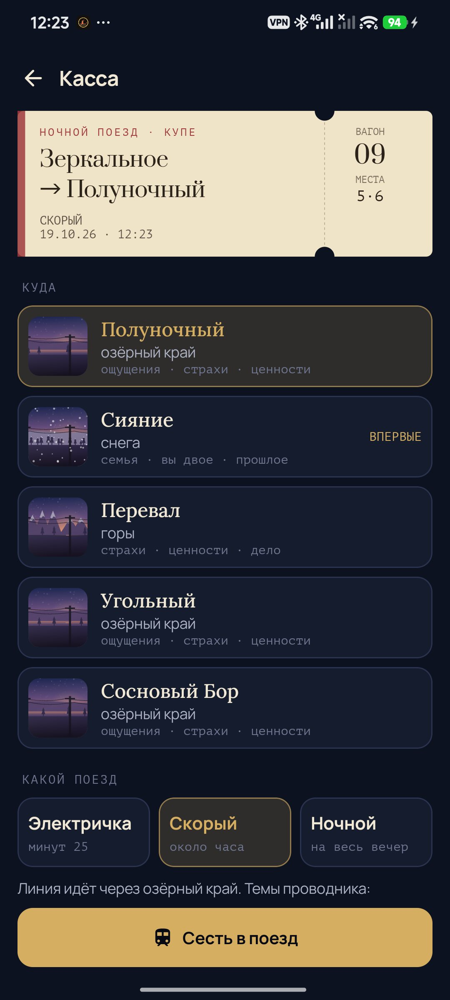 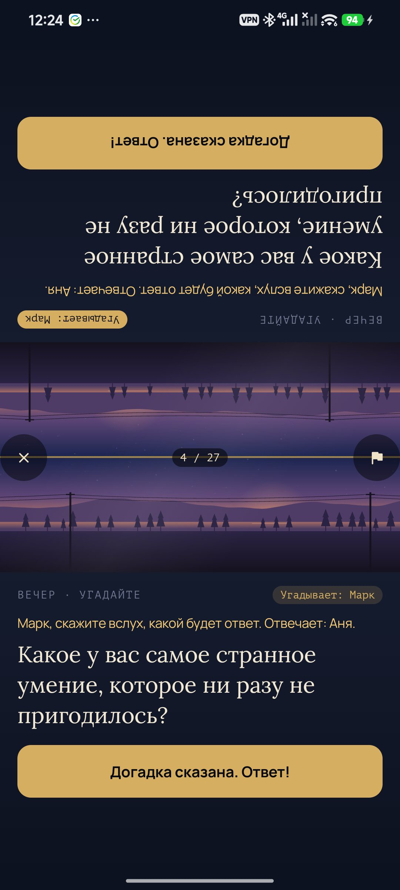 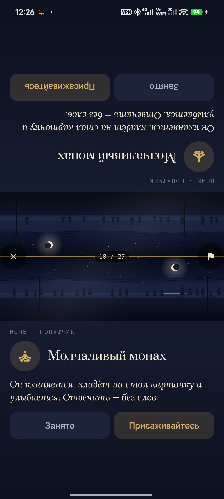 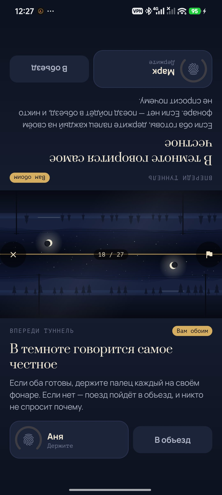 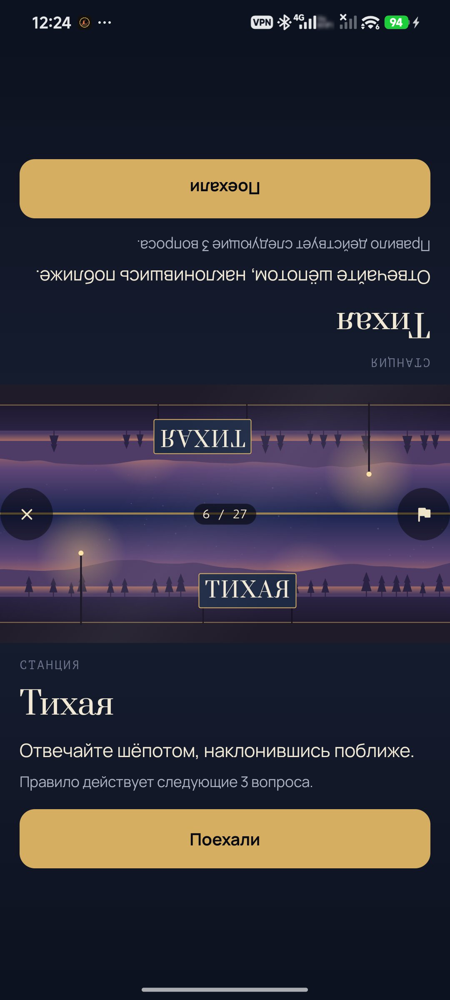 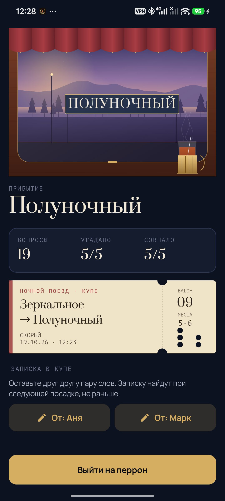 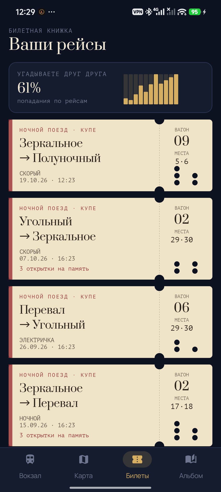 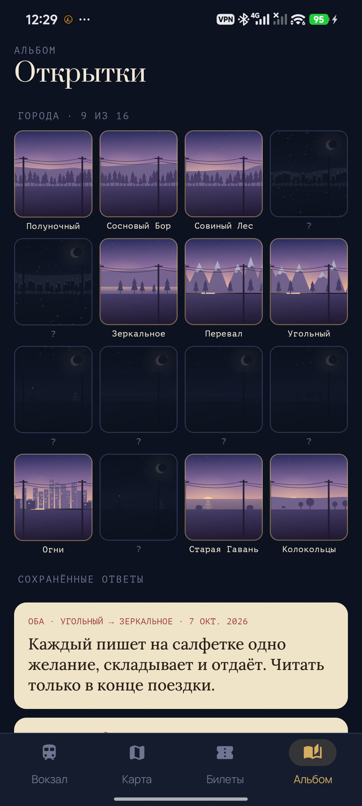

## Сборка

```bash
./gradlew assembleDebug                 # app.nighttrain.dev
./gradlew assembleDebug -Pdemo          # app.nighttrain.demo, четыре выдуманных месяца поездок
./gradlew testDebugUnitTest             # тесты: колода, планировщик рейса, железная дорога, копии
./gradlew assembleDebug -Pdemo -Pshots  # app.nighttrain.shots, окно не движется
bash tools/capture.sh docs/screenshots/ru ru   # проезжает рейс на телефоне и снимает скриншоты
python tools/strings.py app/src/main/res       # строки обоих языков из одной таблицы
```

Карточки лежат в `app/src/main/assets/cards/*.tsv`, по одной в строке: id, вид, часть ночи, тема, флаги, английский, русский. Kotlin, Jetpack Compose, Room, DataStore. Пейзажи, окно, карта и билеты нарисованы процедурно на Compose canvas, стук колёс синтезируется. Шрифты: Prata, Lora, Manrope и PT Mono (OFL).

Часть [Stillcraft](https://bigdevwhale.github.io/stillcraft/). Лицензия MIT.
